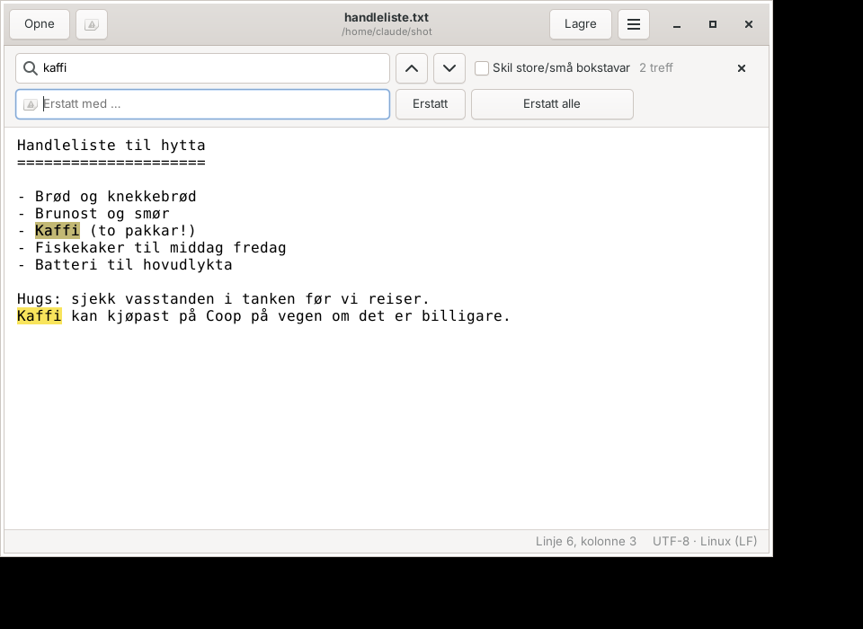

# Froditor

Ein enkel tekstbehandlar for Linux, i stil med Notisblokk. Opnar og lagrar
vanlege `.txt`-filer og PowerShell-skript (`.ps1`) – verken meir eller mindre.



## Installasjon

Fungerer på Debian 12+, Ubuntu 22.04+, Linux Mint og andre Debian-baserte system.

```bash
wget -O /tmp/froditor.deb https://frodolini.github.io/Froditor/froditor_latest_all.deb
sudo apt install /tmp/froditor.deb
```

Froditor ligg då i programmenyen, og kan òg startast frå terminalen:

```bash
froditor notat.txt
```

### Oppdatering

Pakka legg sjølv til Froditor si signerte APT-kjelde. Nye versjonar kjem
derfor med vanleg oppdatering – anten i programvareoppdateraren eller med:

```bash
sudo apt update && sudo apt upgrade
```

### Avinstallering

```bash
sudo apt purge froditor
```

`purge` fjernar òg APT-kjelda. Med `remove` blir ho liggjande att.

## Funksjonar

- Ny, opne, lagre og lagre som (UTF-8), med `.txt` eller `.ps1` som filtype
- Nye `.ps1`-filer får UTF-8 med BOM, slik at Windows PowerShell les æ, ø og å rett
- Les òg eldre Windows-filer (Windows-1252, UTF-16) og tek vare på linjeskift (LF/CRLF)
- Angre og gjer om
- Søk og erstatt, med markering av alle treff
- Linjebryting av/på, val av skrifttype og zoom
- Spør før ulagra endringar går tapt
- Hugsar innstillingane i `~/.config/froditor/settings.json`

| Snarveg | Handling |
| --- | --- |
| Ctrl+N / Ctrl+Shift+N | Nytt dokument / nytt vindauge |
| Ctrl+O | Opne |
| Ctrl+S / Ctrl+Shift+S | Lagre / lagre som |
| Ctrl+Z / Ctrl+Shift+Z | Angre / gjer om |
| Ctrl+F / Ctrl+H | Søk / søk og erstatt |
| F3 / Shift+F3 | Neste / førre treff |
| Ctrl+ + / Ctrl+ − / Ctrl+0 | Større / mindre / vanleg tekst |
| Ctrl+W / Ctrl+Q | Lukk vindauge / avslutt |

## Utvikling

Køyr rett frå kjeldekoden:

```bash
sudo apt install python3-gi gir1.2-gtk-4.0
python3 -m froditor
```

Testar:

```bash
python3 -m unittest discover -s tests -t . -v
```

Byggje .deb-pakka lokalt (utan APT-kjelda):

```bash
packaging/build-deb.sh            # → dist/froditor_<versjon>_all.deb
```

### Ny versjon

1. Endre `__version__` i `froditor/__init__.py` (valfritt – taggen vinn).
2. Lag og push ein tag:

   ```bash
   git tag v1.0.1
   git push origin v1.0.1
   ```

GitHub Actions testar koden, byggjer `.deb`-pakka, lagar ein release og
oppdaterer APT-kjelda på GitHub Pages. Etter nokre minutt får alle maskiner
den nye versjonen ved neste `apt upgrade`.

### Førstegongsoppsett av repoet

Dette trengst berre éin gong:

1. **Pages:** *Settings → Pages → Build and deployment → Source:* **GitHub Actions**.
2. **Signeringsnøkkel:** køyr `scripts/oppsett-signering.sh` (krev `gpg` og `gh`).
   Han lagar ein nøkkel og lagrar han som hemmelegheita `GPG_PRIVATE_KEY`.

## Struktur

```
froditor/            Kjeldekoden (Python + GTK 4)
data/                Ikon, .desktop-fil og APT-kjelda som blir installert
packaging/           Skript for .deb og APT-kjelde, nettsida på Pages
.github/workflows/   Automatisk bygging og publisering
tests/               Testar
```

Lisens: MIT
